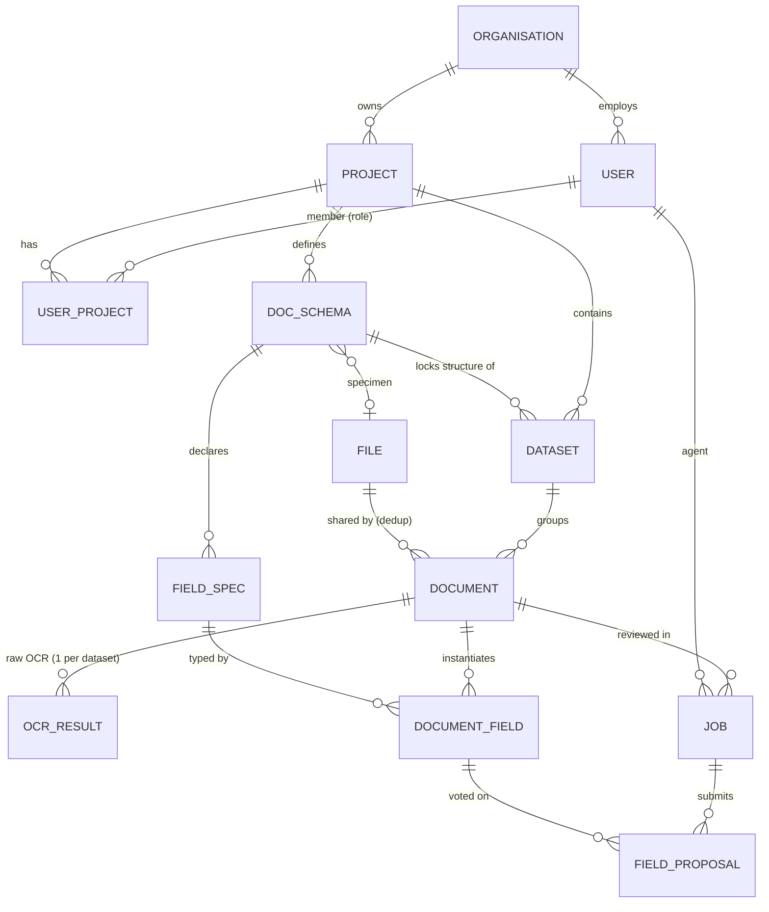
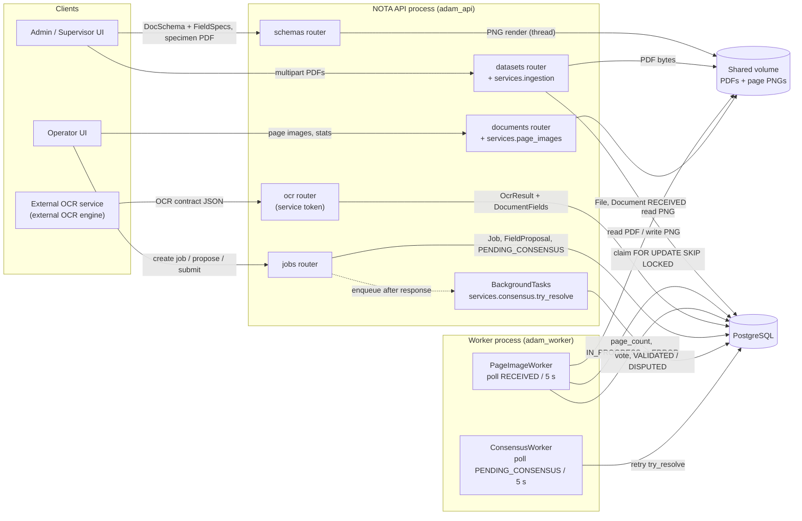
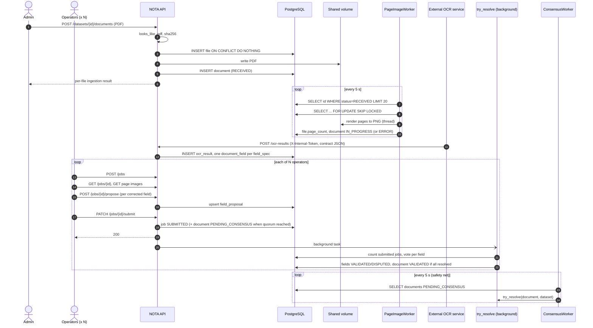
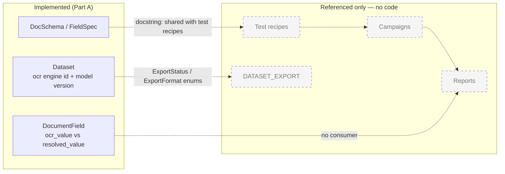

# NOTA Backend — Architecture & Implementation Extraction

> Source: the `nota-back` repository (packages `adam_core`, `adam_api`, `adam_worker`), state as of 2026-09-14.
> Scope: the **Labellisation** and **Automated Testing** business processes.
> Every statement below is traced to code. Where something is only declared (enum, docstring, config key) and never executed, it is marked as such.

---

## 0. Codebase at a glance

| Package | Role | Entry point |
|---|---|---|
| `adam_core` | Shared kernel: SQLAlchemy 2.x async ORM models, Alembic migrations, enums, Pydantic contracts, DB session + row-level scoping, utilities (PDF rendering, hashing, value parsing). Depends on no other NOTA package. | — (library) |
| `adam_api` | FastAPI HTTP API: routers, auth dependencies, domain services (`ingestion`, `consensus`, `page_images`). | `uvicorn adam_api.main:app` |
| `adam_worker` | Background polling workers. | `python -m adam_worker.main` |

Stack: Python 3.12, FastAPI 0.111, SQLAlchemy 2.0 (asyncio) on `asyncpg`, PostgreSQL (uses JSONB, `ARRAY(Float)`, `ON CONFLICT`, `FOR UPDATE SKIP LOCKED`), PyMuPDF for PDF rendering, pytest + pytest-asyncio for engineering tests.

No deployment manifests (container images, orchestration descriptors, schedulers) are in the repository; the runtime topology below is derived from the two process entry points and from how the code addresses storage and callers.

---

# PART A — LABELLISATION

Labellisation = turning scanned PDF forms into validated, structured field values: PDFs are ingested, pre-filled by an external OCR engine, reviewed independently by *N* human operators, and resolved field-by-field by majority vote.

## A.1 Service / Worker Inventory

### Independently running processes

| # | Name | Responsibility (one line) | Trigger | Execution model |
|---|---|---|---|---|
| 1 | **NOTA API** — `adam_api.main:app` | Exposes all REST endpoints (schemas, datasets, ingestion, OCR injection, jobs, documents, files) and persists state. | HTTP requests under `/api/{version}` | Synchronous request/response on an asyncio event loop (uvicorn); CPU-bound steps offloaded to a thread; spawns in-process background tasks (see #4). |
| 2 | **Worker host** — `adam_worker.main._main` | Boots the DB engine and runs every worker concurrently until SIGINT/SIGTERM. | Process start | Single process, single event loop; `asyncio.gather` over each worker's `run_forever()`. |
| 2a | └ **`PageImageWorker`** (`adam_worker/page_image_worker.py`) | Renders each page of newly ingested PDFs to 300-DPI PNG, records `File.page_count`, moves the `Document` from `RECEIVED` to `IN_PROGRESS`. | Polling loop every 5 s (`BaseWorker.poll_interval_seconds`) on `document.status = 'RECEIVED'` | Background worker; batches of 20; render offloaded to a thread (`asyncio.to_thread`); row locks allow multiple instances in parallel. |
| 2b | └ **`ConsensusWorker`** (`adam_worker/consensus_worker.py`) | Safety net: re-runs consensus resolution on every document stuck in `PENDING_CONSENSUS`. | Polling loop every 5 s on `document.status = 'PENDING_CONSENSUS'` | Background worker; sequential over pending documents; each resolution in its own DB session. |
| 3 | **External OCR service** (outside this repo) | Runs the external OCR engine on a document and pushes the result to NOTA. | Calls `POST /ocr-results` with the `X-Internal-Token` header | External, asynchronous with respect to NOTA; authenticated as a `ServiceCaller` (`require_service`). |

### In-process asynchronous unit

| # | Name | Responsibility | Trigger | Execution model |
|---|---|---|---|---|
| 4 | **Consensus background task** — `adam_api.services.consensus.try_resolve` | Tallies operator proposals and resolves each `DocumentField` by strict majority; marks the document `VALIDATED` when every field is resolved. | Queued by `PATCH /jobs/{job_id}/submit` through FastAPI `BackgroundTasks` (also exposed in DEV only via `POST /documents/admin/consensus/resolve/{document_id}`) | Runs inside the API process after the HTTP response is sent; opens its own DB session; exceptions are caught and logged (never propagate). |

### Supporting infrastructure (not NOTA code)

| Component | Role in the process |
|---|---|
| **PostgreSQL** | Single source of truth **and** the coordination medium between API and workers (status columns act as the work queue). |
| **Shared persistent volume** (`settings.pvc_mount_path`) | Stores original PDFs (`{org_slug}/{document_type}/{YYYY_MM_DD}/{file_id}/{name}.pdf`) and rendered pages (`{file_id}/pages/NNNN.png`). Mounted by both API and worker. |
| **Corporate SSO + JWT middleware** | Validates user tokens and applies coarse URI-by-role filtering (YAML config under `conf/`, `adam_api/core/security.py`). Fine-grained authorisation stays in the API. |
| **Annotation front-end (IHM)** | Human UI calling the API with a user JWT. |

### Tooling (run manually, not services)

- `scripts/seed.py` — seeds organisations/users/projects/schemas, optionally deriving a schema from an OCR contract JSON file.
- `scripts/prealim_document.py` — pre-fills a document by posting an *empty* OCR contract to `POST /ocr-results`, which expands every `FieldSpec` into empty `DocumentField` rows.

### Routers involved in labellisation

| Router | Auth dependency | Key endpoints |
|---|---|---|
| `schemas.py` | `get_caller` (user or service) | `POST /schemas`, `POST /schemas/{id}/field-specs`, `POST /schemas/{id}/specimen`, `POST /schemas/{id}/lock`, `POST /schemas/{id}/duplicate`, `GET /schemas/{id}/pages/{n}/image` |
| `datasets.py` | `get_caller` | `POST /datasets`, `POST /datasets/{id}/documents` (multipart PDF ingestion), `GET /datasets/{id}/stats` |
| `ocr.py` | **`require_service`** | `POST /ocr-results` |
| `jobs.py` | per-route `get_db` → `get_caller` | `POST /jobs`, `GET /jobs/{id}`, `POST /jobs/{id}/propose`, `PATCH /jobs/{id}/submit` |
| `documents.py` | `get_caller` | `GET /documents/{id}?view=full`, `GET /documents/{id}/pages/{n}/image`, `GET /documents/{id}/stats`, `PATCH /documents/{id}` (optimistic status check) |
| `files.py` | **`require_service`** | `GET /files/{id}/content`, file metadata CRUD |

## A.2 Data Flow

The process has five phases. Arrows name the data that moves.

**Phase 0 — Schema definition** (administrator / supervisor → API)
1. `POST /schemas` → API: `DocSchema` + list of `FieldSpec` (page, section, `field_key` matching `^[a-z0-9_]+\.[a-z0-9_]+$`, `value_type`, `polygon` of 8 floats, `sensitive`, `description`). Created in one transaction; rejected with 409 if the project already has a schema for that `document_type`.
2. `POST /schemas/{id}/specimen` → API: specimen PDF bytes. The API validates it with PyMuPDF (`looks_like_pdf`), stores it through `get_or_create_file`, and renders its pages **synchronously** (`asyncio.to_thread(render_pages_to_png, …)`) → PNGs on the volume, `File.page_count`, `DocSchema.specimen_file_id`.
3. `POST /schemas/{id}/lock` sets `DocSchema.locked = True` (one-way). Further edits go through `POST /schemas/{id}/duplicate` → new `DocSchema` with `version = max(version)+1`, copied `FieldSpec`s, same specimen `File` row.

**Phase 1 — Ingestion** (business admin → API → volume/DB)
1. `POST /datasets` → `Dataset` (bound to a `project_id`, a `schema_id`, OCR engine identifier/model version, `required_operators` 1–5, default 3).
2. `POST /datasets/{id}/documents` (multipart) → for each file, `services.ingestion.ingest_pdf`:
   - SHA-256 of content (`utils.hashing.sha256_bytes`);
   - if a `Document` already exists **in this dataset** for that hash → `already_exists`;
   - else `get_or_create_file` → `INSERT … ON CONFLICT (sha256_checksum) DO NOTHING RETURNING` → writes bytes to the volume → sets `File.file_path`;
   - creates `Document(status=RECEIVED)`.
   - Response: per-file item (`created` / `created_file_reused` / `already_exists` / `rejected`).

**Phase 2 — Page rendering** (`PageImageWorker` ↔ DB/volume)
1. Worker reads up to 20 `Document.id` with `status = RECEIVED`.
2. For each: `SELECT … FOR UPDATE SKIP LOCKED`, re-checks status, reads `File.file_path`, renders PDF → `{file_id}/pages/0001.png…` at 300 DPI.
3. Writes `File.page_count = n`, `Document.status = IN_PROGRESS` (or `ERROR` if the PDF can't be rendered).
4. Front-end later fetches `GET /documents/{id}/pages/{n}/image` → `services.page_images.serve_page_image` streams the PNG with header `X-Image-Dpi: 300` so the UI can map OCR polygons onto pixels.

**Phase 3 — OCR pre-fill** (external OCR service → API)
1. `POST /ocr-results` with `{document_id, dataset_id, raw_json, storage_mode}`.
2. `raw_json` is validated against the versioned OCR interchange contract (`adam_core/schemas/interface_contract.py`: document → pages → sections → `KVPair` with a discriminated-union `KVValue` of type text/number/date/datetime/boolean, each carrying `confidence` and `polygon`).
3. API stores `OcrResult` (raw JSONB), loads all `FieldSpec` of the dataset's schema, indexes OCR pairs by `(section_id, field_key)`, and creates one `DocumentField` **per FieldSpec** (even if OCR found nothing) with `ocr_value`, `resolved_value` (= OCR value), `ocr_confidence`, `ocr_polygon`, `status = PENDING`. Existing fields are skipped. `Document.status = IN_PROGRESS`.

**Phase 4 — Human review** (operator front-end ↔ API)
1. `POST /jobs` → `Job(state=ASSIGNED)`. `step = VALIDATION` if no job for this document has been submitted yet, otherwise `CONSENSUS`.
2. `GET /jobs/{id}` → document fields grouped by page → section, with this operator's own proposal on each field (operators never see each other's values through this endpoint).
3. `POST /jobs/{id}/propose` → upsert `FieldProposal(job_id, document_field_id, value, value_type, reason)`; first call moves the job to `IN_PROGRESS` and stamps `started_at`; the `DocumentField` is set to `CORRECTED` with `resolved_value = value`.
4. `PATCH /jobs/{id}/submit` → `Job.state = SUBMITTED`, `submitted_at`; if the number of submitted jobs ≥ `Dataset.required_operators`, `Document.status = PENDING_CONSENSUS`; queues `try_resolve(document_id, dataset_id)` as a background task.

**Phase 5 — Consensus** (background task, then `ConsensusWorker` as fallback)
1. `try_resolve` opens a fresh session and exits early if the document is already `VALIDATED` or if `submitted jobs < required_operators`.
2. Loads all `DocumentField`s and all `FieldProposal`s from `SUBMITTED` jobs, groups proposals by field, and applies `_apply_vote`:
   - no proposal on the field → OCR value accepted (`resolved_value = ocr_value`, `VALIDATED`);
   - top value count **> half** of the proposals → `resolved_value = top value`, `consensus_reached = True`, `VALIDATED`;
   - otherwise → `DISPUTED`, `consensus_reached = False`.
3. All fields resolved → `Document.status = VALIDATED`; otherwise it stays `PENDING_CONSENSUS`, and `ConsensusWorker` retries it every cycle.
4. Progress read-back: `GET /documents/{id}/stats` (validated fields / contributors) and `GET /datasets/{id}/stats` (validated documents).

### Document lifecycle (`adam_core.enums.status.DocumentStatus`)

```
RECEIVED ──PageImageWorker──▶ IN_PROGRESS ──submit (N jobs)──▶ PENDING_CONSENSUS ──try_resolve──▶ VALIDATED
    │                            ▲                                   ▲        │
    └──render failure──▶ ERROR   └── POST /ocr-results               └────────┘ disputed: ConsensusWorker retries
```
`EXPORTED` is declared in the enum and guarded against in `submit_job`, but no export code exists yet.

## A.3 Concurrency / Parallelism Model

**No message broker, no task queue library, no scheduler.** Work is distributed through **PostgreSQL status columns used as a queue**, consumed by polling workers, plus FastAPI's in-process `BackgroundTasks`.

| Mechanism | Where | Details |
|---|---|---|
| **asyncio event loop** | API and worker host | All I/O (DB via `asyncpg`, file I/O via `anyio.Path`) is non-blocking. |
| **`asyncio.gather` of polling loops** | `adam_worker/main.py` | `PageImageWorker` and `ConsensusWorker` run cooperatively in one process; one slow cycle does not block the other beyond event-loop scheduling. |
| **Thread offloading** | `PageImageWorker._process_one`, `schemas.upload_specimen` | `asyncio.to_thread(render_pages_to_png, …)` — PyMuPDF rendering is blocking CPU/disk work, pushed to the default thread pool so the loop stays responsive. |
| **Row-level locking for horizontal scale-out** | `PageImageWorker._lock_document` | `SELECT … FOR UPDATE SKIP LOCKED` + status re-check inside the transaction. Several worker instances (or overlapping cycles) can run: exactly one gets each row, the others skip it silently. Candidate discovery is lock-free; the claim is what's locked. |
| **One transaction per unit of work** | both workers | `get_async_session()` commits on success, rolls back on exception, per document. A failure affects only that document. |
| **Idempotent insert under concurrent ingestion** | `services.ingestion.get_or_create_file` | `INSERT … ON CONFLICT (sha256_checksum) DO NOTHING RETURNING`; the loser of the race re-reads the winning row instead of raising `IntegrityError`. |
| **Optimistic concurrency** | `PATCH /documents/{id}` | Optional `expected_current_status`; mismatch → 409 "Conflit de statut". |
| **Background task after response** | `PATCH /jobs/{id}/submit` | `try_resolve` runs after the response, in its own session (the request session is already closed). |

**Error handling and retry**

| Failure | Handling |
|---|---|
| Any exception in a worker cycle | `BaseWorker.run_forever` logs it and sleeps; the loop never dies. |
| Exception on one document inside a cycle | Caught per document (`PageImageWorker.poll`, `run_pending_consensus`); the rest of the batch continues. |
| Unreadable / corrupt PDF | `PdfRenderError` → document moved to `ERROR` (**poison-pill** pattern), partially written PNGs deleted; without this it would be re-polled forever and block the batch. |
| `try_resolve` background task crashes | Caught and logged; the document stays `PENDING_CONSENSUS` and `ConsensusWorker` retries it on the next 5-second cycle (**implicit retry via polling**, no back-off, no attempt counter). |
| Graceful shutdown | SIGINT/SIGTERM → `worker.stop()` flips `_is_running`; each worker finishes its current cycle before exiting. |

**Known limits visible in the code** (useful for a "limitations / future work" section):
- `try_resolve` takes no row lock, so the background task and `ConsensusWorker` can resolve the same document at the same time. The vote is deterministic, so both produce the same result, but the work is duplicated.
- A document with a genuinely `DISPUTED` field stays `PENDING_CONSENSUS` and is re-evaluated every cycle with the same result, until new proposals arrive. No arbitration endpoint exists yet (the business-admin "arbitrate disagreements" role is documented in `enums/roles.py` only).
- `PageImageWorker` keeps the row lock (open transaction) for the whole render of a document.
- Fixed poll interval (5 s), fixed batch (20); the source flags this as a minimal version ("pas de scheduler", `TODO Sprint 3`).

## A.4 Data Model Highlights



| Entity (table) | What it is | Non-obvious points |
|---|---|---|
| `Organisation` | Client organisation | Isolation root for all row-level filtering. |
| `User` / `UserProject` | Account / project membership | Two role vocabularies: `ProjectRole` (OPERATOR, BUSINESS_ADMIN) on `user_project.role`, `PlatformRole` (NOTA_ADMIN, NOTA_SUPERVISOR, NOTA_CLIENT) on `user.platform_role`. Only ADMIN and SUPERVISOR bypass organisation filtering (`CROSS_ORGANISATION_ROLE_VALUES`); CLIENT does not. |
| `DocSchema` | Versioned structure of a form type | `(project_id, document_type, version)`; `locked` is one-way; `specimen_file_id` lets zones be drawn **without** any dataset. |
| `FieldSpec` | One field in a schema | Unique on `(schema_id, section_id, group_id, field_key)`; `polygon` = `ARRAY(Float)` of 8 values (4 corners); `sensitive` flags personal data; `description` is free text meant to guide extraction. |
| `Dataset` | Batch of documents to label | Fixes the schema (schema change refused once documents exist), the OCR engine identifier + model version, and `required_operators` (1–5) — the consensus quorum. `configs` JSONB is a provisional catch-all. |
| `File` | **Physical** file | Unique by `sha256_checksum`. Not organisation-scoped (no `OrganisationScoped` marker): the same bytes uploaded by two organisations share one row and one path on the volume. |
| `Document` | **Logical** occurrence of a file in a dataset | Dedup is per dataset, so one `File` can back many `Document`s. `page_count` is a Python property read through the `file` relationship (None unless eagerly loaded). |
| `OcrResult` | Raw OCR engine output | Unique `(document_id, dataset_id)` → a document can be pre-filled once per dataset; `storage_mode` JSONB/FILE (only JSONB is implemented). |
| `DocumentField` | The **delivered** value of one field on one document | Carries both sides: `ocr_value`/`ocr_confidence`/`ocr_polygon` (machine) and `resolved_value`/`status`/`consensus_reached` (human outcome). `group_id` instantiates repeatable fields (one `FieldSpec`, many `DocumentField`s). Unique `(document_id, field_spec_id, group_id)`. |
| `Job` | One operator's review pass on one document | `step` (VALIDATION for the first reviewer, CONSENSUS afterwards) and `state` (ASSIGNED → IN_PROGRESS → SUBMITTED / CANCELLED). |
| `FieldProposal` | An operator's vote on a field | Append-per-(job, field), upserted on re-propose; `value_type` NOT NULL and preserved when a re-proposal omits it; indexed on `(document_field_id, step)`. |

**Cross-cutting: automatic row-level scoping** (`adam_core/db/scoping.py`). Models inherit the marker mixins `OrganisationScoped` and/or `ProjectScoped` and implement `__organisation_filter__` / `__project_filter__`, which walk up the FK chain with sub-selects (e.g. `FieldProposal → Job → Dataset → Project → Organisation`). A global SQLAlchemy `do_orm_execute` listener injects `with_loader_criteria` on **every ORM SELECT** from the `organisation_id` and `matricule` stored in `session.info` by `dependencies/db.get_db`. Routers therefore write plain `select(Job)` and still only see rows the caller may see. Service callers and workers open unscoped sessions.

**Schema management quirk:** the first Alembic revision (`init_tables_labellisation`) is empty. Tables are created by `Base.metadata.create_all()` in the API lifespan (`create_tables()`), and Alembic only carries later deltas.

## A.5 Key Design Decisions (with trade-offs)

| # | Decision | Alternative not taken | Why / trade-off |
|---|---|---|---|
| 1 | **Database-as-queue with polling workers** (`status` column + `FOR UPDATE SKIP LOCKED`) | Message broker / distributed task queue | No extra infrastructure to operate; state and "queue" can never diverge (the status *is* the queue); horizontal scaling still works thanks to `SKIP LOCKED`. Cost: up to 5 s latency, constant polling load, no native retry/back-off or dead-letter queue (replaced by the `ERROR` poison-pill state). |
| 2 | **Consensus triggered twice: in-process background task + polling worker** | Only synchronous resolution in `submit_job`, or only the worker | The submit response stays fast and consensus normally lands within the same second; the worker makes the process self-healing if the API process dies or the task fails. Cost: possible duplicate concurrent resolution (safe because the vote is deterministic and idempotent). |
| 3 | **PDF → PNG rendered server-side once, at 300 DPI, stored on the volume** | Render PDF in the browser, or render on demand | The UI gets plain images plus `X-Image-Dpi`, so OCR polygons and `FieldSpec` zones map to pixels exactly; nothing is re-rendered per view. Cost: disk space and an asynchronous stage (documents are unviewable until the worker has run). |
| 4 | **Specimen pages rendered synchronously in the request** (`upload_specimen`) | Reuse `PageImageWorker` | The worker only polls `Document`s in `RECEIVED`; a specimen is a bare `File` with no document, so it would never be picked up. One file, one admin action → acceptable request latency. |
| 5 | **Content-addressed files (SHA-256) split from logical documents** | One file row per upload | Storage dedup across datasets and organisations, idempotent re-uploads, concurrency-safe via `ON CONFLICT`. Cost: the on-disk path reflects the *first* uploader's organisation/date; the `file_id` path segment was added so two different files with the same name on the same day can't overwrite each other. |
| 6 | **Validate uploads by parsing with PyMuPDF**, never by content-type or file name | Trust MIME/extension | Client-supplied metadata can be forged; file names are reduced to `Path(name).name` to block path traversal. Cost: every upload is opened and parsed once. |
| 7 | **Strict majority per field; untouched fields accept the OCR value** | Unanimity, weighted votes, confidence thresholds | Simple, explainable, deterministic. Note the majority is computed over the proposals actually made on that field, not over `required_operators`. Operators only record disagreements with OCR, so a field nobody changed counts as validated OCR. Ties → `DISPUTED`, pending an arbitration feature. |
| 8 | **OCR is pushed in by an external service** (`POST /ocr-results`, service token) rather than called by NOTA | NOTA worker calling the OCR engine | Keeps the engine choice and its runtime out of the labelling platform; NOTA only enforces the versioned interchange contract (Pydantic discriminated union, fail-fast on unknown types). The `ocr_mock_*`/`ocr_timeout_seconds` settings and `Dataset.ocr_job_enabled` exist, but no OCR client calls them in this repo. |
| 9 | **Always create a `DocumentField` for every `FieldSpec`**, even without OCR output | Only create fields the OCR found | The review UI always shows the full form grid; this also enables "blank pre-fill" (`scripts/prealim_document.py` posts an empty contract). |
| 10 | **Immutable, versioned schemas** (`locked` + `duplicate`; HTTP 423 while a non-draft dataset uses the schema) | Editing schemas in place | Documents already labelled against a schema version never have their field definitions change underneath them. Cost: version proliferation and copied `FieldSpec` rows. |
| 11 | **Authorisation in the ORM layer** (global `do_orm_execute` filter) | `WHERE organisation_id = …` in every router | Filtering is secure by default: a forgotten filter can't leak data between organisations. Cost: implicit behaviour, nested sub-selects on every query, and a deliberate unscoped session for caller resolution and workers. |
| 12 | **Authentication by SSO, authorisation by the NOTA database** | Roles carried in the token / YAML | The corporate token only carries the identity (matricule); organisation and roles live in `user`/`user_project`. Unknown-but-authenticated users get **403, not 401**. The URI-by-role YAML is only a coarse outer fence. The CORS middleware must be mounted outside the JWT middleware so preflight requests aren't rejected. |
| 13 | **`lazy="noload"` on every relationship** | Default lazy loading | Async SQLAlchemy can't lazy-load implicitly; `noload` forces explicit `selectinload`, making N+1 queries visible. Cost: unloaded relationships silently read as empty (hence the `Document.page_count` property guard). |

## A.6 Diagrams

### Services and data flow



### Sequence — one document end to end



---

# PART B — AUTOMATED TESTING

## B.0 Finding: this business process is **not implemented** in this repository

This was checked against the current branch, the full git history (9 commits, from the upstream baseline snapshot onward), and the upstream baseline archive. **No service, worker, router, ORM model, migration, or scheduled job implements Automated Testing.** Sections B.1–B.6 therefore can't be filled in with real architecture. Describing one would be guessing.

What *does* exist is only **declarative traces** that show the process is planned in the product scope:

| Trace | Location | Content |
|---|---|---|
| Product name | `pyproject.toml` (`description`), `README.md` | "NOTA — anNotation et **Tests Automatisés**"; keyword `tests automatises`. |
| Role definition | `adam_core/enums/roles.py` (`PlatformRole.NOTA_SUPERVISOR` docstring) | The supervisor is responsible for "reference datasets, **test recipes, campaigns, reports**, export, locking". |
| Schema reuse intent | `adam_core/models/doc_schema.py` docstring | "A schema is versioned and shared between datasets **and test recipes**". No test-recipe table or FK exists. |
| Export placeholders | `adam_core/enums/status.py` (`ExportStatus`, "State of a `DATASET_EXPORT` export"), `DocumentStatus.EXPORTED`, `DatasetStatus.EXPORTED`, `enums/roles.py` (`ExportFormat` JSON/CSV/PDF) | Enums only; no `dataset_export` table, no export endpoint or worker. |
| OCR engine traceability columns | `Dataset.ocr_provider`, `Dataset.ocr_model_id`; `DocumentField.ocr_value` vs `resolved_value`, `ocr_confidence` | These columns exist and are populated by labellisation. The code doesn't use them for any comparison, scoring or reporting. |

## B.1 Service / Worker Inventory
None. There is no testing service, campaign runner, or scheduled evaluation job. The worker host (`adam_worker.main`) registers only `PageImageWorker` and `ConsensusWorker`.

## B.2 Data Flow
None implemented.

## B.3 Concurrency / Parallelism Model
None implemented. If the process is built later, the existing worker infrastructure (`BaseWorker` polling loop, `FOR UPDATE SKIP LOCKED` claiming, poison-pill `ERROR` status) is the reusable pattern in the codebase. That is an observation about available building blocks, not about existing code.

## B.4 Data Model Highlights
No dedicated tables. The only related structures are the labellisation entities listed in B.0.

## B.5 Key Design Decisions
None recorded in code for this process.

## B.6 Diagram
Only the planned-but-absent position of the process can be drawn from the traces above. Dashed boxes = referenced in docstrings/enums only, no code.



## B.7 Not to be confused with: the engineering test suite

The repository contains a **developer test suite**. It is software-quality tooling, not the Automated Testing business process, but it may be worth describing in the Implementation chapter:

- `tests/unit/` — 26 pytest modules (`pytest-asyncio`, `asyncio_mode = "auto"`, `httpx` for API calls) covering every router, `services.consensus`, `services.ingestion`, `BaseWorker`, `PageImageWorker`, organisation/project scoping (`test_org_scoping.py`), JWT middleware and caller resolution, the OCR interchange contract, `field_parser`, `pdf_render`, hashing and logging. `tests/integration/` is empty.
- Quality gates in `pyproject.toml`: coverage `fail_under = 80`; pylint `fail-under = 9.0`; docstring coverage (interrogate) `fail-under = 95`; mypy with the SQLAlchemy plugin; bandit security lint; black. `scripts/run_checks.ps1` runs black, pylint, mypy, bandit and pytest+coverage locally.
- No CI pipeline definition is committed in the repository.
